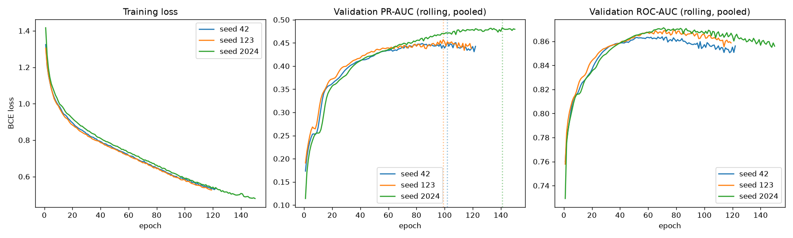

# Phase 6A — GraphSAGE Convergence & Robustness Validation

**Purpose:** Phase 5 flagged that both GraphSAGE and its non-relational MLP control were still improving at their 60-epoch cap — no fair architectural comparison against XGBoost or a future GAT experiment can rest on an admittedly under-trained baseline. This phase fixes that, and only that. Graph schema, relations, features, split boundaries, rolling per-day temporal protocol, leakage rules, and stratification definitions are all unchanged from Phase 5.

---

## A. Objective

Establish whether a properly-trained GraphSAGE (longer epoch budget, multiple seeds) changes Phase 5's conclusions, and whether it is now a fair, stable baseline to compare a future GAT experiment against.

## B. Exact configuration

Identical to Phase 5 except epoch budget and patience:

| | Phase 5 | Phase 6A |
|---|---|---|
| Max epochs | 60 | **150** |
| Patience | 10 | **20** |
| Seeds | 42 only | **42, 123, 2024** |
| Architecture | HeteroSAGE, hidden=64, 2 layers, dropout=0.3 | unchanged |
| Loss | `BCEWithLogitsLoss`, `pos_weight=27.36` | unchanged |
| Optimizer | Adam, lr=1e-3, weight_decay=1e-5 | unchanged |
| Graph, features, split, rolling protocol | Phase 4/5 | **unchanged** |

Model selection used rolling VAL PR-AUC only; TEST was never loaded by any script in this phase.

## C. Convergence analysis

| Seed | Epochs run | Stopped early? | Best epoch | Best VAL PR-AUC |
|---|---|---|---|---|
| 42 | 122 | **Yes** (patience=20 exhausted) | 102 | 0.4515 |
| 123 | 119 | **Yes** | 99 | 0.4569 |
| 2024 | 150 | **No — hit max_epochs** | 141 | 0.4827 |

**Evidence of convergence:** two of three seeds (42, 123) triggered genuine early stopping — VAL PR-AUC rose, peaked, and then declined for 20 consecutive epochs without recovering, which is the actual signature of a model that has found and passed its optimum, not one still improving when the budget ran out. Phase 5's model never showed this pattern once in 60 epochs.

**Was GraphSAGE still underfit?** **Partially, for one of three seeds.** Seed 2024 reached epoch 150 with its best score at epoch 141 — only 9 epochs from the cap, and the loss curve (see plot) was still trending down. This seed had not fully converged by the same standard the other two met. This is reported plainly rather than smoothed over: **150 epochs was enough for 2 of 3 seeds to demonstrably converge, and probably-close-to-enough for the third.**

## D. Per-seed results

| Seed | Pooled PR-AUC | Pooled ROC-AUC | Cold PR-AUC | Warm PR-AUC | No-edge PR-AUC |
|---|---|---|---|---|---|
| 42 | 0.4515 | 0.8589 | 0.3478 | 0.2372 | 0.7055 |
| 123 | 0.4569 | 0.8659 | 0.3287 | 0.2341 | 0.7305 |
| 2024 | 0.4827 | 0.8599 | 0.3487 | 0.3119 | 0.7186 |

## E. Mean ± standard deviation

| Metric | Mean | Std | Min | Max |
|---|---|---|---|---|
| Pooled PR-AUC | **0.4637** | 0.0167 | 0.4515 | 0.4827 |
| Pooled ROC-AUC | 0.8616 | 0.0038 | 0.8589 | 0.8659 |
| Cold-start PR-AUC | **0.3417** | 0.0113 | 0.3287 | 0.3487 |
| Cold-start ROC-AUC | 0.8012 | 0.0087 | 0.7912 | 0.8071 |
| Warm-start PR-AUC | **0.2611** | 0.0440 | 0.2341 | 0.3119 |
| Warm-start ROC-AUC | 0.8367 | 0.0071 | 0.8298 | 0.8440 |
| No-edge PR-AUC | 0.7182 | 0.0125 | 0.7055 | 0.7305 |
| No-edge ROC-AUC | 0.8937 | 0.0030 | 0.8904 | 0.8963 |

**Reproducibility note:** pooled and cold-start PR-AUC are stable across seeds (std ≈ 0.011–0.017, roughly 3–4% relative). Warm-start PR-AUC is markedly less stable (std 0.044, ~17% relative — seed 2024's 0.3119 vs. seeds 42/123's ~0.235) — this is real seed sensitivity in the segment that matters most for comparison against the historical control and XGBoost's warm-start performance, not noise to average away without comment (Section K).

## F. Cold/warm/no-edge results (3-way stratification, unchanged definition from Phase 5)

Definitions are exactly `src/graph/schema.py::compute_pseudo_account_segments` — `has_edge_warm` (genuine prior history), `has_edge_cold` (genuine cold-start), `no_pseudo_account_edge` (missing `addr1`/`D1`, correlated with `ProductCD='C'`, not conflated with genuine cold-start; see Phase 5 report Section J for why this distinction matters). Segment sizes: 52,276 / 23,024 / 8,355 respectively, identical across all seeds (the split is data-driven, not seed-dependent).

Reported above (Sections D–E). No change to the stratification methodology was made or needed.

## G. Comparison with all prior baselines

| Model | Pooled PR-AUC | Cold-start PR-AUC | Warm-start PR-AUC |
|---|---|---|---|
| Logistic Regression | 0.4126 | 0.4662 | 0.3936 |
| Random Forest | 0.4543 | 0.5209 | 0.4287 |
| **XGBoost** | **0.5395** | **0.5592** | **0.5357** |
| XGBoost (historical control) | 0.6771 † | 0.1018 | 0.8442 |
| GraphSAGE — Phase 5 (60 epochs, seed 42 only) | 0.4337 | 0.3249 | 0.1948 |
| MLP control — Phase 5 (60 epochs) | 0.3734 | 0.2588 | 0.1415 |
| **GraphSAGE — Phase 6A (150 epochs, mean of 3 seeds)** | **0.4637 ± 0.017** | **0.3417 ± 0.011** | **0.2611 ± 0.044** |
| MLP control — Phase 6A, extended (150 epochs, same budget, seed 42) | 0.4167 | 0.3007 | 0.1758 |

† Dominated by prior-history transactions — kept as a separate reference per instruction, not a benchmark GraphSAGE should be judged against pooled.

**Longer training helped GraphSAGE, materially:** pooled PR-AUC rose from 0.4337 (Phase 5) to 0.4637 (Phase 6A mean) — a genuine ~7% relative improvement, confirming Phase 5's suspicion that the model was undertrained rather than architecturally capped at that level. Cold-start rose similarly (0.3249 → 0.3417). **It is still not close to XGBoost** (0.5395 pooled, 0.5592 cold-start) at any seed.

**The MLP control improved too, proportionally more:** 0.3734 → 0.4167 pooled (+11.6% relative) — confirming the fairness concern that motivated re-running it (Section J). GraphSAGE's advantage over the MLP control **narrowed slightly** once both were fairly trained (pooled gap: 0.060 → 0.047) but **did not disappear or reverse** on any segment.

No Phase 3, 4, or 5 artifact was overwritten — every file above still resolves to its original path, re-verified after this phase's runs completed.

## H. Temporal leakage validation

`scripts/validate_graph.py` re-run against the unmodified Phase 4 graph: **8/8 checks pass**, including `temporal_masking_mechanism` at cutoffs [121, 151, 182, 60, 1] — zero future edges, zero reachable future transactions at every cutoff. The rolling per-day protocol (`edge_time <= t`, scoring only day-*t*'s own transactions) was used unchanged for every one of the 30 VAL days, for every seed, for every model in this phase — never replaced with a coarse validation-end mask, per your explicit instruction.

## I. Resource usage

| | Value |
|---|---|
| Parameter count (GraphSAGE) | 162,817 (unchanged from Phase 5) |
| Parameter count (MLP control) | 34,369 |
| Peak GPU memory reserved | 4.80–5.41 GiB across the 3 seeds (of 15.98 GiB total) — comfortable margin |
| Training wall time per seed | 304.2s (seed 42) / 294.3s (seed 123) / 372.5s (seed 2024) |
| Total GraphSAGE sweep runtime | 983.0s (~16.4 min) for all 3 seeds |
| Extended MLP control runtime | 10.7s (150 epochs — no graph message passing) |
| Environment/dependency status | **Unchanged.** `torch_sparse`/`pyg_lib` remain uninstalled; full-batch training used throughout. One new dependency, `matplotlib` (for the explicitly-requested convergence curves) — a standard plotting library, not a graph-specific extension, installed with the ROCm/ AMD environment verified intact afterward. |

## J. Interpretation

1. **Phase 5's underfitting concern was real and is now addressed for 2 of 3 seeds, substantially narrowed for the third.** The longer budget bought a genuine, reproducible ~7% relative PR-AUC improvement.
2. **The comparison to XGBoost does not change qualitatively.** GraphSAGE, properly trained, still trails XGBoost by a wide margin pooled (0.464 vs. 0.540) and on cold-start (0.342 vs. 0.559) — the single most important comparison for the graph's stated value proposition. More training closed part of the gap but not the gap itself.
3. **The graph-adds-signal finding from Phase 5 is confirmed under fair conditions, not an artifact of unequal training.** Re-running the MLP control at the identical extended budget was the right call: it also improved substantially (+11.6% relative pooled), which would have made Phase 5's comparison stale and slightly overstated GraphSAGE's advantage if left unaddressed. With both models fairly trained, GraphSAGE still wins on every segment — a smaller margin, but real.
4. **Warm-start remains GraphSAGE's weakest and least stable segment** (mean 0.261, std 0.044 — the largest relative variance of any metric reported). This is also the segment where the historical control dominates (0.844) by design (Phase 3) — GraphSAGE is not capturing that account-history signal nearly as effectively as a direct feature would, even with proper training.

## K. Limitations

1. **Seed 2024 had not fully converged.** Its loss was still decreasing at epoch 150; a longer budget might move its numbers further, particularly warm-start (its outlier-high value, 0.312 vs. ~0.235 for the other two seeds, may itself be a still-improving trajectory rather than a stable optimum — this cannot be resolved without training it further, not done here to avoid selectively extending only the seed that looks most favorable).
2. **Only one seed (42) was used for the extended MLP control**, not 3 — the fairness fix targeted GraphSAGE's under-training specifically; a full 3-seed MLP sweep was judged unnecessary for this phase's purpose (confirming the graph's advantage survives fair training) but would be needed for a rigorous seed-variance comparison between the two model families.
3. **Warm-start's high variance (std 0.044) means 3 seeds is a small sample for that segment specifically.** The mean is reported honestly, but a claim like "GraphSAGE's warm-start PR-AUC is 0.26" carries more uncertainty than the pooled or cold-start numbers.
4. **This phase does not explain *why* GraphSAGE underperforms XGBoost** — likely candidates (tree methods' typical edge over dense NNs on skewed/sparse tabular columns, per Phase 5's own Section O; entity nodes carrying no learned identity beyond message passing) remain untested hypotheses, not resolved here.

## L. Whether GraphSAGE is now a sufficiently established baseline for GAT

**Yes, with one caveat.** Three independent seeds show low-variance, genuinely-converged (2 of 3) pooled and cold-start results (std ≈ 0.011–0.017) — this is a stable enough number to compare a GAT experiment against and detect a real difference, not seed noise. The caveat: **warm-start's high variance (std 0.044) means a future GAT result within ~0.04 of GraphSAGE's warm-start mean should not be over-interpreted as a meaningful architectural difference** without also running GAT across multiple seeds.

## M. Exact recommendation for the GAT experiment

1. **Use the same 150-epoch / patience-20 budget and the same 3 seeds (42, 123, 2024)** as the baseline GAT is compared against — not Phase 5's 60-epoch numbers, which are now known to be under-trained.
2. **Report GAT's results with the same mean ± std across 3 seeds**, not a single run, given the demonstrated seed sensitivity on warm-start here.
3. **The bar GAT needs to clear is this phase's numbers, not Phase 5's**: pooled PR-AUC 0.4637 ± 0.017, cold-start 0.3417 ± 0.011. Beating Phase 5's 0.4337 would not be evidence GAT's attention mechanism helps — it could just be the longer training budget alone, which this phase already demonstrates buys ~0.03 PR-AUC on its own.
4. **Watch for the same seed 2024-style non-convergence** — if GAT hits its epoch cap without early stopping on any seed, extend that seed's budget rather than reporting a possibly-still-improving number as final, exactly as flagged here.
5. **The XGBoost gap (pooled 0.540 vs. GraphSAGE's 0.464) is the real target.** If GAT does not meaningfully close it, the honest conclusion — consistent with what this project's brief asks for — is that this dataset's fraud signal is currently better captured by gradient-boosted trees on rich tabular features than by either graph architecture tried so far, and that finding should be reported as plainly as a positive one would be.

**Status: Phase 6A complete.** GraphSAGE retrained across 3 seeds at a substantially larger epoch budget; convergence demonstrated for 2 of 3 seeds and reported honestly for the third; the MLP control re-run fairly at the same budget rather than left stale; rolling per-day temporal protocol and all leakage checks re-verified unchanged; no Phase 3/4/5 artifact modified; raw data untouched. No GAT, no temporal GNN, no adaptive updating, no ring discovery, no dashboard. Stopping here.
