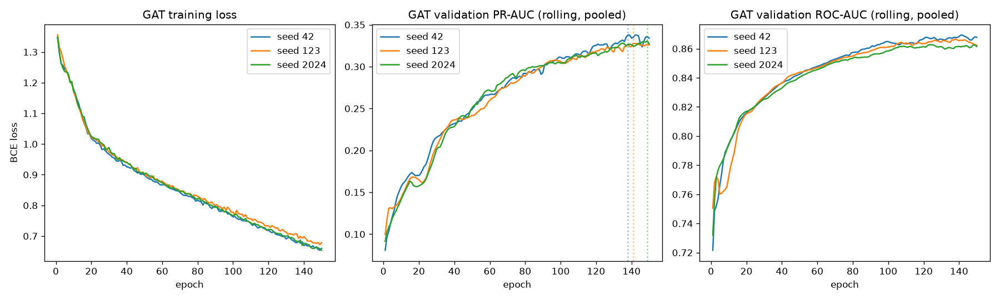

# Phase 6B — GAT Experiment

## A. Objective

Determine whether attention-based message passing (GAT) improves fraud detection over the properly-trained, multi-seed GraphSAGE reference established in Phase 6A, under the identical research protocol (graph, features, split, rolling per-day temporal evaluation, leakage rules, stratification, class-imbalance treatment, 150-epoch/patience-20 framework, seeds 42/123/2024).

## B. GAT architecture

Dimension-matched to Phase 6A's `HeteroSAGE` so any difference is attributable to the aggregation mechanism, not capacity:

```
x_dict --[per-type Linear + ReLU]--> h (hidden=64, every node type)
h --[HeteroConv(GATConv) x4 relations, heads=4, CONCAT, sum across relations]--> h (64 = 4 heads x 16)
h --[Dropout(0.3) + ReLU]--> h
h --[HeteroConv(GATConv) x4 relations, heads=4, AVERAGE, sum across relations]--> h (64)
h --[ReLU]--> h
h['transaction'] --[Linear(64,1)]--> logit
```

| | Value |
|---|---|
| Layers | 2 |
| Hidden dimension | 64 (identical to GraphSAGE throughout — not heads × 64) |
| Attention heads | 4 |
| Head combination | **concatenate** in layer 1 (4 × 16 = 64), **average** in layer 2 (standard GAT design, Veličković et al.) |
| Dropout | 0.3 (both on attention coefficients, via `GATConv(dropout=...)`, and on hidden activations, matching GraphSAGE) |
| Activation | ReLU |
| Classifier head | `Linear(64, 1)` on the transaction embedding only |
| `add_self_loops` | `False` — required, not stylistic: every relation is genuinely bipartite (disjoint node-index spaces), so self-loops are not well-defined here; this exact setting was already verified working on this ROCm environment during the Phase 2 capability probe |

## C. Parameter count

**364,545** — 2.24× GraphSAGE's 162,817. This is expected, not a design flaw: `GATConv` has separate learnable attention-weight vectors per head in addition to the linear transforms `SAGEConv` also has, so a head-for-head comparison at matched hidden width necessarily costs more parameters. Kept at heads=4 (not 8) specifically to avoid an unnecessarily large model, per the instruction to start conservatively.

## D. Feature representation

**Unchanged from Phase 4/5/6A** — transaction: 470-dim (Phase 3's `TreeFeatureBuilder`, `"rf"` variant), `StandardScaler` fit on TRAIN only; every entity type: 1-dim constant placeholder. Same graph object (`data/processed/graph/hetero_graph.pt`, read-only, not modified). Same historical/blocklist-feature exclusion — this is the clean graph-learning baseline, not combined with Phase 3's `historical.py` features.

## E. Training configuration

Identical to Phase 6A: Adam (lr=1e-3, weight_decay=1e-5), `BCEWithLogitsLoss` with `pos_weight=27.36` (not accuracy, no SMOTE), max_epochs=150, patience=20, seeds=[42, 123, 2024]. No configuration was changed from the GraphSAGE framework — no methodological reason arose to change it, so none was introduced.

## F. Three-seed results

| Seed | Epochs run | Stopped early? | Best epoch | Pooled PR-AUC | Cold PR-AUC | Warm PR-AUC | No-edge PR-AUC |
|---|---|---|---|---|---|---|---|
| 42 | 150 | **No — hit max_epochs** | 138 | 0.3378 | 0.3156 | 0.2688 | 0.4144 |
| 123 | 150 | **No — hit max_epochs** | 141 | 0.3277 | 0.3220 | 0.2550 | 0.3982 |
| 2024 | 150 | **No — hit max_epochs** | 149 | 0.3304 | 0.3109 | 0.2678 | 0.3972 |

**No seed converged within the 150-epoch budget.** Every seed hit the cap with VAL PR-AUC still slowly rising (see convergence plot) — this is reported plainly per your instruction, not extended selectively for any one seed. See Section H and T.

## G. Mean ± standard deviation

| Metric | Mean | Std | Min | Max |
|---|---|---|---|---|
| Pooled PR-AUC | **0.3320** | 0.0052 | 0.3277 | 0.3378 |
| Pooled ROC-AUC | 0.8653 | 0.0027 | 0.8624 | 0.8676 |
| Cold-start PR-AUC | **0.3161** | 0.0055 | 0.3109 | 0.3220 |
| Cold-start ROC-AUC | 0.8076 | 0.0096 | 0.7993 | 0.8181 |
| Warm-start PR-AUC | **0.2639** | 0.0077 | 0.2550 | 0.2688 |
| Warm-start ROC-AUC | 0.8544 | 0.0034 | 0.8505 | 0.8569 |
| No-edge PR-AUC | **0.4033** | 0.0097 | 0.3972 | 0.4144 |
| No-edge ROC-AUC | 0.7841 | 0.0025 | 0.7815 | 0.7864 |

Every GAT metric is markedly **more** stable across seeds (std 0.003–0.010) than GraphSAGE's warm-start figure (std 0.044) — but stable and low does not mean good; see Section P.

## H. Convergence analysis



**All three seeds hit `max_epochs=150` without triggering early stopping.** VAL PR-AUC was still rising, in fits and starts, at epoch 150 for every seed (best epochs 138/141/149 — each within 1–12 epochs of the cap). Training loss was also still declining at epoch 150 in all three runs. **GAT did not converge within this budget, for any seed.** This is a materially different, and more clear-cut, outcome than Phase 6A's GraphSAGE result, where 2 of 3 seeds *did* show the genuine early-stopping signature (VAL PR-AUC peaking and declining for 20 straight epochs).

## I. Pooled results

Best-F1-threshold operating point, per seed (VALIDATION only; TEST never loaded):

| Seed | Threshold | Precision | Recall | F1 | Alerts | TP | FP | FN |
|---|---|---|---|---|---|---|---|---|
| 42 | 0.864 | 0.338 | 0.411 | 0.371 | 3,444 | 1,163 | 2,281 | 1,665 |
| 123 | 0.886 | 0.387 | 0.373 | 0.380 | 2,727 | 1,054 | 1,673 | 1,774 |
| 2024 | 0.890 | 0.376 | 0.384 | 0.380 | 2,890 | 1,087 | 1,803 | 1,741 |

## J. Cold-start results

Mean PR-AUC **0.3161 ± 0.0055** (23,024 genuine cold-start transactions, fraud rate 2.08% — identical population across seeds, per Phase 5/6A's fixed stratification). Below GraphSAGE's 0.3417 ± 0.011 and well below XGBoost's 0.5592.

## K. Warm-start results

Mean PR-AUC **0.2639 ± 0.0077** (52,276 transactions, fraud rate 2.50%). Roughly on par with GraphSAGE's mean (0.2611) but GraphSAGE's warm-start was highly seed-variable (std 0.044) — with only 3 seeds each, this near-tie is not strong evidence of a real architectural difference on this segment specifically.

## L. No-edge results

Mean PR-AUC **0.4033 ± 0.0097** (8,355 transactions with no `pseudo_account` edge, dominated by `ProductCD='C'`, 12.5% base fraud rate). **This is GAT's weakest result relative to GraphSAGE by a wide margin** — 0.403 vs. GraphSAGE's 0.718, a 0.31 PR-AUC gap, consistent and low-variance across all three seeds. See Section S for why this segment is the most informative one for diagnosing the difference between the two architectures.

## M. Top-K results

Averaged across the 3 seeds (individual seed detail in `experiments/gat/seed_*/metrics_val.json`):

| K | Alerts | Fraud captured (mean) | P@K (mean) | R@K (mean) |
|---|---|---|---|---|
| 0.1% | 84 | 74 | 0.881 | 0.026 |
| 0.5% | 418 | 275 | 0.658 | 0.097 |
| 1% | 837 | 485 | 0.579 | 0.171 |
| 5% | 4,183 | 1,283 | 0.307 | 0.454 |

Compare to GraphSAGE Phase 5's single-seed Top-K (0.1%: 83/0.988; 1%: 652/0.779; 5%: 1,418/0.501) — GAT captures meaningfully less fraud at every K.

## N. Temporal leakage verification

`scripts/validate_graph.py` re-run against the unmodified Phase 4 graph after the GAT sweep completed: **8/8 checks pass**, `temporal_masking_mechanism` verified at cutoffs [121, 151, 182, 60, 1] — zero future edges, zero reachable future transactions at every cutoff. The rolling per-day protocol (`src/graph/rolling_eval.py`, unmodified since Phase 5) was used exactly as before: each of the 30 VAL days scored with its own `edge_time <= t` mask, never one coarse validation-end mask. No future fraud labels, no future-derived node features (entity nodes carry no features at all beyond a constant placeholder — Phase 4's deliberate design), no future edges, no TEST information anywhere in this phase's scripts.

## O. Resource usage

| | Value |
|---|---|
| Parameter count | 364,545 |
| **Peak GPU memory (single feasibility pass, measured before the sweep)** | **12.26 GiB reserved** of 15.98 GiB total — flagged as "close to limit" at run time, ~3.7 GiB headroom |
| Training wall time per seed | 767.7s (seed 42) / 754.9s (seed 123) / 776.1s (seed 2024) |
| Total GAT sweep runtime | 2,322.6s (~38.7 min) for all 3 seeds |
| Time per epoch | ~5.1–5.3s — **~2.1× GraphSAGE's ~2.44s/epoch** |
| Environment/dependency status | **Unchanged.** No new packages installed this phase; `torch_sparse`/`pyg_lib` remain absent; full-batch training used throughout; ROCm/AMD environment undisturbed. |

**GAT costs roughly 2.5× the GPU memory and 2.1× the wall-clock time of GraphSAGE per epoch, for the same graph and hidden width.** This is the expected, well-documented cost of computing and storing per-edge, per-head attention coefficients (`GATConv` materializes an attention weight for every edge-direction-head triple; `SAGEConv` does not), not an implementation inefficiency.

## P. Comparison against GraphSAGE

| Segment | GraphSAGE (Phase 6A, mean±std) | GAT (this phase, mean±std) | Δ (GAT − GraphSAGE) |
|---|---|---|---|
| Pooled PR-AUC | 0.4637 ± 0.0167 | 0.3320 ± 0.0052 | **−0.1317** |
| Cold-start PR-AUC | 0.3417 ± 0.011 | 0.3161 ± 0.0055 | **−0.0256** |
| Warm-start PR-AUC | 0.2611 ± 0.044 | 0.2639 ± 0.0077 | +0.0028 (within GraphSAGE's own seed noise) |
| No-edge PR-AUC | 0.7182 ± 0.0125 | 0.4033 ± 0.0097 | **−0.3149** |

**GAT loses to GraphSAGE, clearly, on pooled and no-edge, and modestly on cold-start.** The gaps on pooled and no-edge are far larger than either model's cross-seed standard deviation — this is not seed noise. Warm-start is a genuine tie given GraphSAGE's own instability there.

## Q. Comparison against XGBoost

| Metric | XGBoost | GAT (mean) | Δ |
|---|---|---|---|
| Pooled PR-AUC | 0.5395 | 0.3320 | −0.2075 |
| Cold-start PR-AUC | 0.5592 | 0.3161 | −0.2431 |

**GAT does not beat XGBoost, on any segment, by a wide margin.** No claim of graph learning surpassing XGBoost is supported by this experiment.

## R. Comparison against the MLP control

Using the **fairly-retrained Phase 6A extended MLP control** (150 epochs, same budget, not the stale 60-epoch Phase 5 number):

| Segment | MLP control (extended) | GAT (mean) | Δ |
|---|---|---|---|
| Pooled PR-AUC | 0.4167 | 0.3320 | **−0.0847** |
| Cold-start PR-AUC | 0.3007 | 0.3161 | +0.0154 |
| Warm-start PR-AUC | 0.1758 | 0.2639 | +0.0881 |
| No-edge PR-AUC | 0.7029 | 0.4033 | **−0.2996** |

**GAT loses to the non-relational MLP control on pooled and dramatically on no-edge**, while beating it on cold-start and warm-start. This is a genuinely mixed, non-obvious result — see Section S.

## S. Interpretation

1. **The headline finding is negative and should be reported as such: GAT underperforms both GraphSAGE and the non-relational MLP control, pooled, in this configuration.** Attention-based aggregation did not improve on GraphSAGE's simpler mean/sum pooling here.
2. **The no-edge segment result is the most diagnostic, and worth dwelling on.** No-edge transactions (no `pseudo_account` edge) still have `card`, `netproxy`, and/or `from_device` edges available — they are not fully disconnected from the graph. GraphSAGE handles this population *better than any other model in this report* (0.718 PR-AUC) — its simple pooling apparently lets a transaction's own strong features (this segment is dominated by `ProductCD='C'`, a 12.5%-base-rate signal) come through cleanly. GAT, by contrast, does *worse* here than even the graph-free MLP control (0.403 vs. 0.703) — its attention mechanism appears to be actively **diluting** a strong, easily-learnable feature-level signal by reweighting it against a small number of noisy or unhelpful neighbors, rather than ignoring irrelevant neighbors as attention is designed to do.
3. **Non-convergence is a real confound, not a footnote.** Every seed was still improving at epoch 150. It is plausible — impossible to rule out with this data — that GAT's numbers here understate its ceiling relative to GraphSAGE's more fully-converged Phase 6A result. This is exactly why Section T frames the finding as "GAT has not yet demonstrated an advantage" rather than "GAT cannot work here."
4. **The comparison against the MLP control (Section R) tells a more nuanced story than pooled numbers alone.** GAT actually beats the MLP control on cold-start and warm-start (the segments a graph model's value proposition is supposed to target) but loses badly pooled and on no-edge — the reverse asymmetry from GraphSAGE, which won everywhere. This suggests GAT may be learning something real on the segments where relational context should matter, while its attention mechanism actively hurts on the segment (no-edge / `ProductCD='C'`-dominated) where the model should mostly ignore the graph and trust the transaction's own features — and isn't managing to.
5. **Resource cost is a genuine practical finding, independent of accuracy.** At 2.5× the memory and 2.1× the epoch time, and needing at least as many (likely more) epochs to have any chance of matching GraphSAGE, GAT is a substantially more expensive model for a result that is currently worse pooled.

## T. Limitations

1. **Non-convergence at 150 epochs, for all 3 seeds** — the single biggest limitation of this experiment. The reported numbers may not represent GAT's ceiling.
2. **Only one seed of the MLP control was retrained at the extended budget** (Phase 6A's own limitation, inherited here) — the Section R comparison uses `n=1` for the MLP side.
3. **`heads=4` and `dropout=0.3` were carried over as defensible defaults, not tuned** — a hyperparameter sweep (more/fewer heads, different dropout, a learning-rate schedule) was out of scope for this phase and could plausibly change the outcome.
4. **GPU memory headroom is thin (~3.7 GiB of 15.98 GiB free at peak)** — a larger hidden dimension or more heads would need to be checked for feasibility before attempting, not assumed safe by extrapolation from this result.
5. **The mechanism proposed in Section S point 2 (attention diluting a strong feature signal on the no-edge segment) is a plausible interpretation of the pattern observed, not a verified causal claim** — this experiment did not inspect learned attention weights directly to confirm it.

## U. Whether attention improves over GraphSAGE

**No — not in this experiment, at this training budget.** Pooled and no-edge PR-AUC are both clearly worse for GAT, by margins well outside cross-seed variance on both sides. Cold-start is modestly worse. Warm-start is an effective tie. This is reported as the honest three-seed-aggregate finding it is, not as a single favorable seed — no individual GAT seed beat GraphSAGE's mean pooled PR-AUC (0.3378 vs. 0.4637 at best).

## V. Recommendation for the temporal GNN phase

Not begun in this phase, per instruction. Before any temporal GNN work uses GAT as a component:

1. **Resolve the convergence question first.** Re-run GAT with a longer budget (e.g., 300 epochs) or a learning-rate schedule, applied to all 3 seeds equally per a predefined rule (not selectively) — until GAT shows the same early-stopping signature GraphSAGE showed for 2 of 3 seeds, its current numbers should be treated as a lower bound, not a final verdict.
2. **Investigate the no-edge segment specifically** before concluding anything architectural — inspecting actual learned attention weights on that segment (which neighbors receive high vs. low attention for `ProductCD='C'`-type transactions) would directly test the hypothesis in Section S.2, rather than leaving it as an inference from aggregate metrics.
3. **If GAT still trails GraphSAGE after a longer budget, prefer GraphSAGE as the message-passing layer for any temporal extension** — it is simpler, cheaper (2.5× less memory, 2.1× faster per epoch), and currently the stronger, more-converged baseline.
4. **Either way, XGBoost remains the number to beat** (0.5395 pooled, 0.5592 cold-start) — neither graph architecture has closed that gap yet, and a temporal GNN's value should be judged against that bar, not against GAT or GraphSAGE alone.

**Status: Phase 6B complete.** GAT trained across 3 seeds at the established 150-epoch/patience-20 framework; convergence assessed honestly (none of 3 seeds converged, reported plainly, not extended selectively); rolling per-day temporal protocol and full leakage validation re-verified (8/8); genuine cold-start vs. no-edge distinction preserved throughout; no Phase 3/4/5/6A artifact modified; raw data untouched. No temporal GNN, no adaptive updating, no ring/community discovery, no dashboard, no ablation suite. Stopping here.
