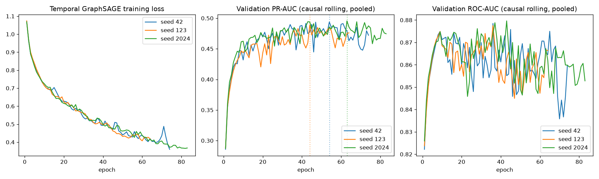

# Phase 7 — Temporal GNN (Temporal GraphSAGE with recurrent entity memory)

**Scope:** one temporal GNN, three seeds, one static-vs-temporal ablation, full leakage validation. TEST was never loaded. Not begun: adaptive updating, drift monitoring, ring discovery, explainability, the final ablation suite, dashboard.

## Headline (read this first)

| | Static GraphSAGE (6A) | **Temporal GraphSAGE (7)** | XGBoost | GAT (6B) |
|---|---|---|---|---|
| Pooled PR-AUC | 0.4637 ± 0.0167 | **0.4927 ± 0.0035** | 0.5395 | 0.3320 ± 0.0052 |
| Cold-start PR-AUC (strict def.) | 0.3417 ± 0.0113 | **0.3562 ± 0.0071** | 0.4064 † | 0.3161 ± 0.0055 |
| Convergence | 2 of 3 seeds early-stopped | **3 of 3 seeds early-stopped** | — | 0 of 3 |
| Peak GPU memory | ~4.8–5.4 GiB | **1.88 GiB** | — | 12.3 GiB |

† XGBoost's *established* cold-start figure is 0.5592 (Phase 3's 2-way definition); on the strict 3-way segments used for every graph model it is 0.4064. Both are reported in Section R — the established value is not replaced.

- The temporal model beats static GraphSAGE pooled in **3 of 3 seeds** (+0.029; seed diffs +0.042/+0.032/+0.013; paired p ≈ 0.08 at n = 3). It does **not** beat XGBoost on any segment.
- On cold-start and no-edge the gain over static is **not distinguishable from zero** (2 of 3 seeds each; p = 0.28 / 0.45).
- **The comparison is confounded by training regime** (Section W.1): the recurrent model is trained with truncated BPTT (~17 optimizer steps/epoch vs 1 for the full-batch static model) — a standard choice I did not vary. This report therefore does **not** claim the gain is caused by temporal information.
- The validation suite initially **failed 6 of 19 checks**. That was traced to a defect in my test harness, not the model (Section U); the final suite passes 19/19 on CPU (bitwise-exact) and GPU.

---

## A. Research objective
Test whether explicitly modeling the *temporal evolution* of the relational graph adds fraud signal beyond (1) tabular XGBoost, (2) static GraphSAGE, (3) non-relational controls — under the frozen chronological split and the rolling causal protocol. The hypothesis is tested, not assumed.

## B. Why temporal modeling is required
The static GraphSAGE (Phases 5/6A) recomputes an entity's embedding by mean-pooling *all* of its history uniformly, with no notion of order, recency, or elapsed time; time enters only as a mask (`edge_time <= t`). If fraud behavior around an entity evolves, that pooling cannot represent it. Two earlier findings motivate the test: Phase 1/3 showed drift is *conditional* (label rate and entity turnover), not covariate; and Section X shows every model's lift decays across the validation window. Adding a timestamp column to static GraphSAGE would not be a temporal GNN and was not done.

## C. Temporal GNN architecture
Feasibility inspection found the preferred design (Temporal GraphSAGE + recurrent state) fully implementable with the existing stack (PyG `SAGEConv`, `torch.nn.GRUCell`; no compiled extensions). Transactions and edges are chronologically sorted, so each day is a contiguous slice, and daily snapshots are tiny (mean 3,319 transactions). **No architecture substitution was needed.**

One step per day *d*, strictly in order:
```
day-d transactions --[Linear(470,64)+ReLU]--> hx
1. GraphSAGE layer 1 (txn -> entity), per relation, on the DAY-d snapshot only:
       m_e = SAGE( hx ; root = entity's previous memory s_e(d-1) )      -> ReLU -> Dropout(0.3)
2. Recurrent update, entities touched on day d only:
       s_e(d) = GRUCell( [m_e, elapsed-time encoding(2)] , s_e(d-1) )   (one GRU per entity type)
3. GraphSAGE layer 2 (entity -> txn), summed over the 4 validated relations:
       z = ReLU( sum_r SAGE_r( s_e(d) ; root = hx ) )  ->  Linear(64,1) -> fraud logit
```
| | |
|---|---|
| GraphSAGE layers | 2 message-passing hops (txn→entity, entity→txn) — same depth as static |
| Hidden dimension | 64 (unchanged) |
| Recurrent unit | `GRUCell(66 → 64)`, one per entity type (4) |
| Recurrent hidden dim | 64 |
| Dropout | 0.3 (on layer-1 messages; not on the memory itself) |
| Classifier | `Linear(64,1)` on the transaction embedding |
| Graph | Phase 4 schema unchanged: same 4 node types, 4 relations |

**Why this is a genuine temporal GNN:** entity state is a function of the *ordered* sequence of earlier snapshots; earlier graph state reaches later predictions only through the recurrence; the GRU can learn forgetting/recency. This is verified empirically, not just asserted: corrupting days 116–121 changes later predictions by 10–17 logits (Section U, `past_sensitivity`).

## D. Temporal state / memory mechanism
- **State:** one 64-dim vector per entity (220,452 entities, 56 MB), plus a last-active-day counter. Untouched entities keep their state (no decay); the elapsed-time input (`log1p(gap)`, `is_new`) tells the GRU how stale it is.
- **Initial state:** never-seen entities read a *learned* per-type vector `h0` (a prior for cold-start), not zeros.
- **No labels, ever:** state is built from features and structure only. No fraud label from any time enters a state, so no future — or past — label can leak. (Consequence: it does not reproduce the historical-control's label-propagation signal by design; that control stays separate.)
- **Same-day visibility:** day-d transactions read day-d snapshot messages (matching the static protocol's day granularity). State updated at day *d* influences predictions at days ≥ *d* only.
- **Truncated BPTT:** gradients flow through state updates within a 7-day training window; `detach_state` cuts the graph at window boundaries while state *values* carry forward — never reset.
- **Train → validation boundary:** evaluation rebuilds state from day 1 with the *current* parameters in eval mode, then continues **without reset** through days 122–151 (state carried from day 121 into day 122). Verified bitwise-exact by `train_val_boundary_state_continuity`.
- **Validation → test boundary:** *not executed* (TEST sealed). Designated procedure: continue the same stream from day 151 with the final parameters, never reset, never using labels. The dataset builder **refuses** TEST days (`max_day > 151`), verified by `no_test_data_loaded`.

## E. Snapshot / window definition
1-day snapshots (matching every earlier temporal decision). Per-day size, days 1–151:

| | mean | max |
|---|---|---|
| Transactions | 3,319 | 6,852 |
| `charged_to` edges / entities touched | 2,946 / 2,277 | 5,994 / 4,016 |
| `used_card` edges / entities | 3,319 / 1,083 | 6,852 / 1,832 |
| `via_network` edges / entities | 804 / 237 | 4,085 / 644 |
| `from_device` edges / entities | 414 / 154 | 3,307 / 706 |

Bottleneck: Python/kernel-launch overhead over ~150 tiny steps per pass (not memory or FLOPs) — the opposite of the static model, whose cost is full 810K-node passes.

## F. Parameter count
**197,889** (static GraphSAGE 162,817 → 1.22×; GAT 364,545). Breakdown: input projection 30,144 · learned `h0` 256 · layer-1 SAGE ×4 33,024 · GRU ×4 101,376 · layer-2 SAGE ×4 33,024 · head 65.

## G. Feature representation
Identical to Phases 5/6A/6B: 470-dim transaction features (Phase 3 `TreeFeatureBuilder`, `"rf"` variant), `StandardScaler` fit on TRAIN rows only (checked: TRAIN standardized, VAL not centred). Entity nodes have no engineered features. Historical/blocklist features are **not** used. Only days ≤ 151 are moved to the GPU (501,214 transactions).

## H. Training configuration
| | Static (6A) | Temporal (7) |
|---|---|---|
| Loss | BCE, `pos_weight=27.36` | same |
| Optimizer | Adam 1e-3, wd 1e-5 | same |
| Max epochs / patience | 150 / 20 | same |
| Seeds | 42, 123, 2024 | same |
| Optimizer steps per epoch | 1 (full batch) | **~17** (7-day truncated-BPTT windows) |
| Gradient clipping | none | **norm 1.0** |

The last two rows are the only deviations. Both were chosen *a priori* with the recurrent architecture and were not tuned: truncated BPTT is the standard practice for memory-based temporal GNNs (I did not test full 121-step BPTT, so I make no claim about whether it would fit or perform differently), and gradient clipping is standard for recurrent nets. Precisely because they differ from the static regime, they are the confound discussed in W.1.

**Pilot (not a result):** train days 1–28, eval days 29–35 (inside TRAIN), 3 epochs — verified execution, a falling loss, 0.84 GiB, ~1.8 s/epoch extrapolated (actual full-run 1.66–1.74 s), and the causality checks. Its metrics are marked `PILOT_NOT_A_RESULT.txt` and are not used anywhere.

## I. Three-seed results
| Seed | Epochs run | Best epoch | Pooled PR-AUC | Pooled ROC-AUC | Cold PR-AUC | Warm PR-AUC | No-edge PR-AUC |
|---|---|---|---|---|---|---|---|
| 42 | 74 | 54 | 0.4938 | 0.8673 | 0.3587 | 0.3287 | 0.7288 |
| 123 | 64 | 44 | 0.4888 | 0.8657 | 0.3618 | 0.3085 | 0.7216 |
| 2024 | 83 | 63 | 0.4956 | 0.8672 | 0.3482 | 0.3266 | 0.7308 |

## J. Mean ± standard deviation
| Metric | Mean | Std | Min | Max |
|---|---|---|---|---|
| Pooled PR-AUC | **0.4927** | 0.0035 | 0.4888 | 0.4956 |
| Pooled ROC-AUC | 0.8667 | 0.0009 | 0.8657 | 0.8673 |
| Cold PR-AUC / ROC-AUC | **0.3562** / 0.7954 | 0.0071 / 0.0119 | 0.3482 / 0.7831 | 0.3618 / 0.8068 |
| Warm PR-AUC / ROC-AUC | **0.3213** / 0.8474 | 0.0111 / 0.0043 | 0.3085 / 0.8437 | 0.3287 / 0.8522 |
| No-edge PR-AUC / ROC-AUC | **0.7271** / 0.8943 | 0.0049 / 0.0011 | 0.7216 / 0.8931 | 0.7308 / 0.8952 |

## K. Convergence analysis


**All three seeds converged by the early-stopping criterion**: validation PR-AUC peaked, then failed to improve for 20 epochs (stopping epochs 74/64/83; best epochs 54/44/63) while training loss kept falling — the overfitting signature of a model that has passed its optimum. No seed hit the 150-epoch cap. This is cleaner than static GraphSAGE (2 of 3) and GAT (0 of 3). *Caveat:* "epochs" are not comparable across models — the temporal model takes ~17 optimizer steps per epoch (best epochs 44–63 ≈ 750–1,070 steps) versus 100–141 single-step epochs for static.

## L. Pooled results (best-F1 threshold chosen on VALIDATION only)
| Seed | Threshold | Precision | Recall | F1 | Alerts | TP | FP | FN |
|---|---|---|---|---|---|---|---|---|
| 42 | 0.963 | 0.555 | 0.463 | 0.505 | 2,357 | 1,309 | 1,048 | 1,519 |
| 123 | 0.945 | 0.548 | 0.448 | 0.493 | 2,312 | 1,266 | 1,046 | 1,562 |
| 2024 | 0.962 | 0.560 | 0.452 | 0.500 | 2,284 | 1,279 | 1,005 | 1,549 |

(83,655 validation transactions, 2,828 fraud.) For reference XGBoost at its own threshold: precision 0.617, recall 0.464, F1 0.530, 2,127 alerts, 814 FP.

## M. Cold-start results (genuine cold-start; no-edge kept separate)
23,024 transactions, 2.08% fraud. **PR-AUC 0.3562 ± 0.0071** vs static 0.3417 ± 0.0113 (+0.0145 ± 0.0170; temporal ahead in 2/3 seeds; p = 0.28). Not a demonstrated improvement.

## N. Warm-start results
52,276 transactions, 2.50% fraud. **PR-AUC 0.3213 ± 0.0111** vs static 0.2611 ± 0.0440 (+0.0602 ± 0.0403; 3/3 seeds; p = 0.12). Largest gain, but static's warm-start was its least stable metric, so much of the *variance* reduction (std 0.044 → 0.011) is as notable as the mean. Still far below the historical control's warm-start (0.93 strict / 0.84 Phase 3) — expected, since this model sees no labels.

## O. No-edge results (missing `addr1`/`D1`; dominated by `ProductCD='C'`)
8,355 transactions, 12.5% fraud. **PR-AUC 0.7271 ± 0.0049** vs static 0.7182 ± 0.0125 (+0.0089 ± 0.0164; 2/3 seeds; p = 0.45). No difference.

## P. Top-K results (mean of 3 seeds)
| K | Alerts | Fraud captured | P@K | R@K | XGBoost captured (Phase 3) |
|---|---|---|---|---|---|
| 0.1% | 84 | 83.7 | 0.996 | 0.030 | 84 |
| 0.5% | 418 | 382.7 | 0.916 | 0.135 | 391 |
| 1% | 837 | 705.0 | 0.842 | 0.249 | 748 |
| 5% | 4,183 | 1,595.7 | 0.382 | 0.564 | 1,649 |

Temporal GraphSAGE matches XGBoost at the very top of the ranking and trails it progressively (−43 frauds at 1%, −53 at 5%).

## Q. Static GraphSAGE vs Temporal GraphSAGE (the required ablation)
Seed-matched, same graph/features/loss/seeds/protocol; only the model and its (necessarily different) training regime vary.

| Segment | Static | Temporal | Diff (mean ± sd of seed diffs) | Seeds temporal wins | Paired p (n=3) |
|---|---|---|---|---|---|
| Pooled | 0.4637 ± 0.0167 | 0.4927 ± 0.0035 | **+0.0290 ± 0.0149** (per seed +0.042/+0.032/+0.013) | 3/3 | 0.078 |
| Cold | 0.3417 ± 0.0113 | 0.3562 ± 0.0071 | +0.0145 ± 0.0170 | 2/3 | 0.28 |
| Warm | 0.2611 ± 0.0440 | 0.3213 ± 0.0111 | +0.0602 ± 0.0403 | 3/3 | 0.12 |
| No-edge | 0.7182 ± 0.0125 | 0.7271 ± 0.0049 | +0.0089 ± 0.0164 | 2/3 | 0.45 |

The p-values are descriptive — n = 3 has little power and they are not corrected for four comparisons. Note the gain is *largest where static was weakest* (seed 2024, static's best seed, shows the smallest gap, +0.013).

## R. XGBoost comparison
| | Pooled | Cold (established) | Cold (strict) | Warm (strict) | No-edge (strict) |
|---|---|---|---|---|---|
| XGBoost | 0.5395 | 0.5592 | 0.4064 | 0.3496 | 0.7905 |
| Temporal GraphSAGE | 0.4927 | — | 0.3562 | 0.3213 | 0.7271 |
| Gap | −0.0468 | — | −0.0502 | −0.0283 | −0.0634 |

Temporal GraphSAGE closes ~38% of the pooled gap that static GraphSAGE left (0.0758 → 0.0468) but **XGBoost still wins every segment**. The established 0.5592 cold-start reference is kept as reported; it used Phase 3's 2-way segmentation (`account_has_prior_history`, `.fillna("NA")`), which mixes populations the graph experiments separate. On the strict 3-way segments — the *only* like-for-like basis — the cold-start gap is ~0.05, not ~0.20. That re-stratification is supplementary and computed from saved predictions.

## S. GraphSAGE comparison
See Q. Versus the *established* static reference (0.4637 ± 0.0167 / 0.3417 ± 0.011), temporal is +0.029 pooled and +0.015 cold-start, with much lower seed variance.

## T. GAT comparison
Temporal GraphSAGE is +0.161 pooled and +0.040 cold-start over GAT (0.3320 / 0.3161) and uses ~6.5× less GPU memory. GAT did not converge (Phase 6B); Phase 6C remains aborted and its partial artifact was not used or opened.

**All models, strict 3-way segments (PR-AUC; mean over seeds where applicable):**

| Model | Pooled | Cold | Warm | No-edge |
|---|---|---|---|---|
| Logistic Regression | 0.4126 | 0.2972 | 0.1671 | 0.7067 |
| Random Forest | 0.4543 | 0.3807 | 0.2046 | 0.7366 |
| XGBoost | 0.5395 | 0.4064 | 0.3496 | 0.7905 |
| XGBoost historical control ‡ | 0.6771 | 0.0369 | 0.9299 | 0.4960 |
| MLP control (6A, 150 ep.) | 0.4167 | 0.3007 | 0.1758 | 0.7029 |
| GraphSAGE 6A (3 seeds) | 0.4637 | 0.3417 | 0.2611 | 0.7182 |
| GAT 6B (3 seeds) | 0.3320 | 0.3161 | 0.2639 | 0.4033 |
| **Temporal GraphSAGE (3 seeds)** | **0.4927** | **0.3562** | **0.3213** | **0.7271** |

‡ Reference only: its pooled score is dominated by prior-history transactions; it is not an ordinary graph-learning baseline. Established Phase 3 figures (pooled 0.6771; cold 0.1018) are unchanged. On cold-start, Random Forest (0.381) also beats every graph model.

## U. Temporal leakage verification
**Final result: 19/19 checks pass on CPU (deterministic; exact equality required) and 19/19 on GPU (noise-floor tolerance), plus the 8/8 Phase 4 graph suite** (re-run, unchanged).

| Check | Method | Result |
|---|---|---|
| Future invariance | Corrupt *everything* after day *c* (features → large noise, labels flipped, every later edge re-pointed) for c ∈ {122,130,140,150}; compare days ≤ *c* | CPU: **bitwise identical** (Δ = 0) all seeds; GPU: Δ ≤ 3.8e-6 = run-to-run noise floor. Same corruption moves later predictions by 70–530 logits |
| Recurrent memory is used (positive control) | Corrupt days 116–121; compare days ≥ 122 | 10–17 logit change → earlier state **does** influence later predictions |
| Train→val state continuity | Continuous stream vs pause/clone/resume at day 121 | CPU bitwise identical; GPU within noise |
| Per-step access | Instrumented run: each step *d* may read only day *d* | 151/151 steps read exactly their own day |
| No labels in model/state | Dataset built with labels removed entirely | identical predictions |
| No future edges | Edges consumed by steps 1..c == edges with `edge_time ≤ c`, 4 relations, every c ≤ 151 | exact, 0 future / 0 missing |
| No TEST data | `max_day` guard + builder refusal | 501,214 rows (≤ VAL end); TEST refused |
| No future-derived features / scaler | Scaler statistics | fit on TRAIN only (TRAIN std≈1, VAL not centred) |

**The first run failed 6/19 checks, and that must be on the record.** `future_invariance` and `train_val_boundary_state_continuity` failed for all three seeds on GPU. I did not loosen anything to pass them. Analysis (full table in `leakage_validation/NUMERICS_DIAGNOSIS_NOTES.md`): the deviation was ≤ 1.8e-4 logits (5.6e-6 in probability space) versus tens-to-hundreds of logits (~70–530) for a real perturbation; it was *identical* for a 10× larger perturbation, and identical whether I corrupted day 151 or days 140–145 (code cannot read day 151 while processing day ≤ 150). A zero-content-change bit-for-bit copy of the feature array reproduced it exactly. **Root cause: `raw["X"]` is Fortran-ordered, my harness's `ndarray.copy()` returned C-ordered memory, and the GPU chose a different GEMM summation order** (1.831e-4 = 3 float32 ulps at the largest logit, 568). The boundary check's fixed 1e-6 tolerance was also simply tighter than GPU noise (3.8e-6). Fix: layout-preserving perturbations with an explicit layout assertion, a noise floor measured over 4 runs, and exact equality on CPU. The model and its results were not modified; the failing run's JSON is preserved next to the passing ones. In hindsight my original tolerance rule (4× a single pair) was too weak a design — the CPU exact-equality test is the check I would rely on.

## V. Resource usage
| | Temporal GraphSAGE | Static GraphSAGE | GAT |
|---|---|---|---|
| Parameters | 197,889 | 162,817 | 364,545 |
| Peak GPU memory (reserved / allocated) | **1.88 / 1.36 GiB** | ~4.8–5.4 GiB | 12.3 GiB |
| Time per epoch | 1.66–1.74 s | ~2.44 s | ~5.1–5.3 s |
| Runtime per seed | 127 s / 106 s / 144 s | ~294–373 s | ~755–776 s |
| Total (3 seeds) | **383 s (6.4 min)** | 983 s | 2,323 s |

GPU: RX 7900 GRE (15.98 GiB) with ~14 GiB of headroom. Pilot extrapolation (13.4 min worst case) was accurate; early stopping halved it.

**Environment/dependency state.** No graph dependencies installed (`torch_sparse`/`pyg_lib` still absent); torch 2.9.1+ROCm and PyG 2.8.0.post1 untouched. **One incident:** between sessions (2026-09-19 23:16) something outside this project installed packages into the *base* Python 3.12 (Flask, google-genai, pydantic, scikit-learn 1.5.1, scipy 1.17.1, **numpy 1.26.4**), which broke this project's venv (its scipy 1.18.1/scikit-learn 1.9.1 need numpy ≥ 2). I diagnosed it read-only, confirmed torch/ROCm were healthy, then installed `numpy==2.4.4` into the project venv only (`--no-deps`) — the version every earlier phase ran on. The base Python's numpy was left at 1.26.4. Regression suites (22/22 tests, 8/8 dataset checks) pass. Reversible with `pip uninstall numpy` inside the venv.

## W. Limitations
1. **Training-regime confound (the main one).** The static model takes 1 full-batch step per epoch; the temporal model takes ~17 windowed steps and uses gradient clipping — both standard for recurrent models and fixed a priori, but they mean "temporal model beats static" mixes *temporal mechanism* with *a different optimization regime*. A static GraphSAGE trained with matched windowed steps, or a temporal variant with the memory replaced by an order-agnostic accumulator, would separate them; neither was run (both belong to the final ablation suite, which this phase was told not to perform).
2. **n = 3 seeds.** Pooled gain is directionally consistent (3/3) but paired p ≈ 0.08; cold-start and no-edge gains are not distinguishable from zero.
3. **Validation-only.** TEST is sealed, so no final generalization estimate exists; early stopping and thresholds are chosen on validation for every model (equally optimistic for all).
4. **Stale-state mismatch.** During training, state entering each window was built by earlier parameters (standard for memory models); evaluation rebuilds state with fixed parameters. Not quantified.
5. **Day granularity.** Same-day transactions see each other's snapshot messages, as in the static protocol.
6. **No label information in state** by design — so the model cannot recover account-level label structure; this both protects against leakage and caps warm-start performance relative to the historical control.
7. **Extreme logits.** Heavy-tailed standardized features produce |logit| up to 568; this does not affect ranking metrics but calibration/threshold behavior was not investigated.
8. **GPU nondeterminism** (~4e-6 logits) and the layout sensitivity found in U mean bitwise GPU reproducibility is not guaranteed; CPU is exact.
9. **Static reference is itself imperfect:** its seed 2024 had not fully converged (Phase 6A).
10. The Phase 3/4 entity-key inconsistency (`fillna("NA")` vs NaN-propagating) is unresolved; it does not affect this experiment (no historical features), but it is why Phase 3's cold-start figures aren't like-for-like.

## X. Interpretation
1. **A temporal mechanism, correctly built, is feasible, cheap and stable here** — 1.9 GiB, ~6 min for three seeds, all seeds converge, lower seed variance than static, and it demonstrably uses its memory.
2. **It improves on static GraphSAGE pooled, consistently in sign** (+0.029) and reduces warm-start instability, but the gain is modest, not statistically firm at n = 3, and confounded with training regime.
3. **It does not reach XGBoost** on any segment; graph learning has still not beaten strong tabular modeling on this dataset. The like-for-like cold-start gap to XGBoost is ~0.05, smaller than the ~0.20 the established numbers implied.
4. **No evidence of better robustness to shifting behavior.** PR-AUC falls for every model across the validation window (base rate also varies, 3.0–4.0%, so I normalize to lift = PR-AUC ÷ base rate):

| Days | Base rate | Lift: XGBoost | Static | Temporal |
|---|---|---|---|---|
| 122–127 | 3.08% | 22.1× | 19.9× | 21.5× |
| 128–133 | 4.04% | 14.5× | 11.7× | 12.4× |
| 134–139 | 3.19% | 15.2× | 14.1× | 14.6× |
| 140–145 | 3.65% | 12.9× | 10.7× | 11.4× |
| 146–151 | 3.04% | 14.4× | 12.0× | 12.6× |

Temporal's lift decays ~41% from first to last window, static ~40%, XGBoost ~35%. Temporal sits consistently slightly above static, but it does **not** decay more slowly than static — so the "robustness to changing behavior" half of the hypothesis is **not supported** (descriptive, single split).

## Y. Does temporal information add measurable signal?
**Not established — suggestive at best.** What the evidence shows: the temporal architecture scores higher than static pooled in every seed, its memory verifiably influences predictions, and the gain concentrates where static was least stable. What it cannot show: that the gain comes from *temporal information* rather than from the different optimization regime the recurrent model was trained with (W.1); the gain does not clear conventional significance at n = 3; cold-start and no-edge show no detectable benefit; and no drift-robustness benefit appeared. A claim of causality would be unwarranted, and a higher validation score does not by itself show better real-world fraud detection.

## Z. Recommendation for Phase 8 (adaptive updating / concept drift)
Not begun. Suggestions, in priority order:
1. **Before treating "temporal" as a validated component, resolve W.1** in the ablation phase: a schedule-matched static GraphSAGE and a memory-ablated temporal variant (reset or order-agnostic accumulation, same regime).
2. **Use lift, not raw PR-AUC, for drift signals** — base rate swings 3.0–4.0% across weeks and moves PR-AUC on its own. All three model families lose ~35–41% of lift over the 30 validation days, which is a concrete decay for adaptation to target.
3. **The temporal model's low cost (1.9 GiB, ~2 s/epoch, ~2 min/seed) makes frequent re-training a realistic adaptation mechanism**; the static/GAT models cost 2–6× more per epoch.
4. **Carry the CPU exact-equality causality test into any adaptive pipeline** — retraining loops are exactly where state and future data can leak, and the layout-sensitivity found here is a reminder to assert tensor layout when comparing runs.
5. Keep XGBoost as the bar: neither graph nor temporal-graph modeling has yet beaten it.

**Status: Phase 7 complete. Stopping.**

### Artifacts
`experiments/temporal_graphsage/`: `seed_{42,123,2024}/` (checkpoint, config, metrics, predictions, history, resources) · `summary.json` · `comparison.json` · `convergence_curves.png` · `snapshot_stats.json` · `feature_scaler.joblib` · `metadata.json` (incl. state-handling record) · `train_log.txt` · `pilot/` (marked not-a-result) · `leakage_validation/` (CPU + GPU results, graph-suite outputs, the preserved failed run, `numerics_diagnosis.json`, `NUMERICS_DIAGNOSIS_NOTES.md`). Code: `src/graph/temporal.py`, `src/graph/temporal_checks.py`, `src/models/temporal_graphsage.py`, `scripts/{train_temporal_graphsage,validate_temporal_gnn,compare_static_temporal,diagnose_temporal_numerics}.py`. No Phase 3–6C artifact was modified; raw data byte-identical.
