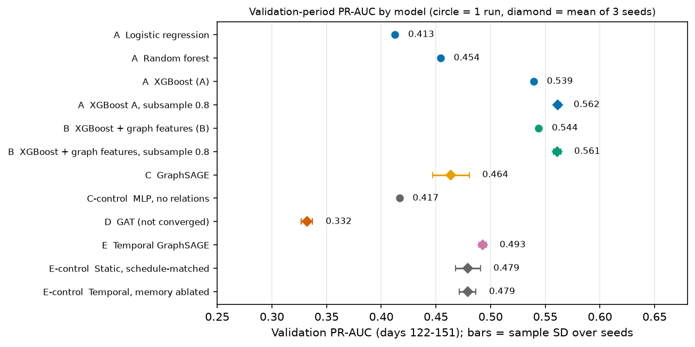
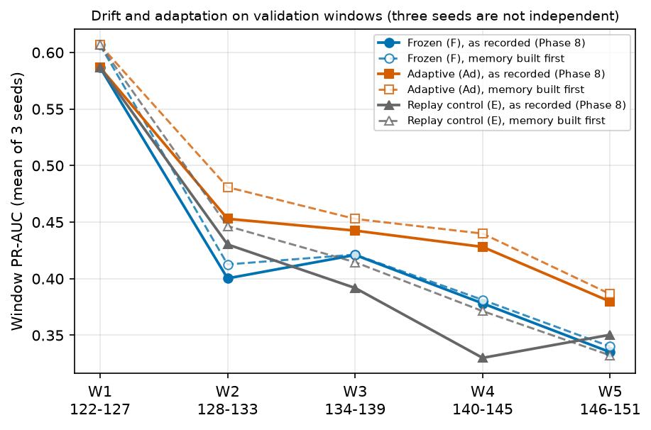
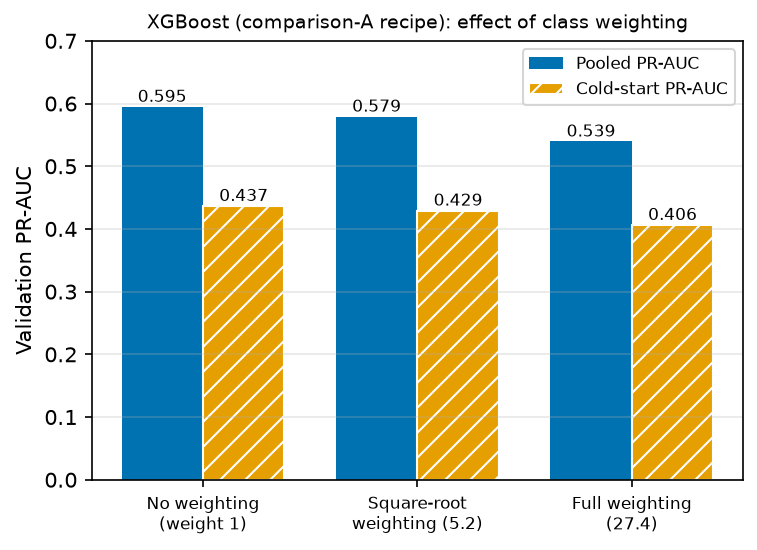

# Adaptive Temporal Graph Intelligence for Fraud Detection & Coordinated Fraud Discovery: a validation-period study on IEEE-CIS

*(The title's final words are abbreviated on purpose: the project's terminology rule forbids ring wording for real-data outputs.)*

**Scope statement.** Every empirical result in this paper is a validation-period result (transaction days 122-151 of the IEEE-CIS training data). Most models were tuned on that period (early stopping, epoch selection or an operating threshold). **No held-out (days 152-182) evaluation has been performed**; it was kept sealed by design and by instruction. Nothing here supports a claim of held-out generalization, statistical significance, causal attribution, fraud or coordination.

## Abstract

We ask whether heterogeneous relational structure and temporal behavioural information improve fraud detection and the discovery of coordinated groups over strong conventional tabular models, particularly under future-time evaluation and concept drift, on the IEEE-CIS Fraud Detection data. We fix a chronological split (train days 1-121, validation 122-151, held-out 152-182 sealed) and evaluate tabular baselines, a leakage-safe handcrafted graph-feature model, GraphSAGE, a graph attention network, a recurrent Temporal GraphSAGE with controls that isolate the memory mechanism, and an adaptive-updating system, all with one shared metric implementation. On the validation period a tuned XGBoost on transaction features (PR-AUC 0.5395) outperforms every neural graph model (best: Temporal GraphSAGE, 0.4927). Forty label-free, strictly backward-looking graph features added to the XGBoost recipe change its validation PR-AUC by +0.0046 in the primary comparison and by -0.0005 on average over three seeds, so the pre-registered rule does not establish a benefit; learned graph models stay below it. A class-imbalance check found that removing class weighting raises XGBoost's PR-AUC from 0.5395 to 0.5948 and gives a similar or higher score for the neural models, without changing the ordering of tabular and neural models. Recurrent entity memory gives a small gain over its controls concentrated in cold-start transactions, and periodic weight updates on newly revealed labels reduce within-validation degradation under a pre-registered rule (three seeds). Discovery of coordinated communities is not established: the synthetic benchmark failed a frozen validity gate, and real-data observations are exploratory and descriptive, with communities treated as candidates only. We document unresolved items openly: the graph attention network never converged, the handcrafted-feature comparison and relationship-level ablations cover only XGBoost, graph evidence for the neural models is missing, and the held-out evaluation has a frozen protocol but has not been run.

**Contributions.** (1) A leakage-aware experimental protocol with strict temporal causality, tested by interventional checks. (2) A consolidated, hash-recorded validation table in which one metric implementation reproduces every recorded metric. (3) A pre-registered comparison of handcrafted versus learned graph information. (4) Evidence on temporal memory and adaptive updating with controls for training regime and training volume. (5) An honest negative and partial-result record, including a failed frozen benchmark gate.

## 1. Introduction

Graph-based fraud detection is often reported with large gains on IEEE-CIS. Phase-1 analysis of this project found a reason for caution: a single strictly backward-looking feature, whether the same pseudo-account had earlier fraud, separates 59.86% fraud from 0.08%, so a graph model with access to neighbours' labels can appear strong by propagating a labelling convention. We therefore treat the hypotheses as tests, with strong tabular baselines, label-free graph features, controls and a record of negative results.

**Hypotheses.** H1: graph structure provides information beyond conventional transaction-level features. H2: learned graph representations provide information beyond handcrafted graph features. H3: temporal information improves generalization to future transactions over static graph modelling. H4: adaptive updating reduces degradation caused by drift. H5: graph analysis identifies suspicious coordinated communities that transaction-level classification cannot characterise.

## 2. Related work

Gradient-boosted trees remain strong on tabular data (Chen & Guestrin, 2016; Grinsztajn et al., 2022). Graph neural networks aggregate neighbour information: GraphSAGE (Hamilton et al., 2017), relational variants (Schlichtkrull et al., 2018) and attention (Velickovic et al., 2018), implemented here with PyTorch Geometric (Fey & Lenssen, 2019). Temporal graph models keep memory of entities (Rossi et al., 2020) using recurrent cells (Cho et al., 2014). Fraud detectors face camouflage (Dou et al., 2020), and a comparison of graph convolution with random forests in anti-money-laundering found trees competitive (Weber et al., 2019). Concept drift adaptation is surveyed by Gama et al. (2014). Community detection uses modularity optimisation (Blondel et al., 2008; the better-connected Leiden variant of Traag et al. (2019) was not used because its backend is not installed). Tree SHAP contributions (Lundberg & Lee, 2017; Lundberg et al., 2020) are the explanation method for tree models. Precision-recall evaluation under class imbalance follows Saito & Rehmsmeier (2015).

## 3. Data and protocol

**Data.** The IEEE-CIS Fraud Detection training data (Vesta Corporation & IEEE-CIS, 2019): 590,540 labelled transactions, 3.499% fraud (imbalance 27.58:1). The competition's own test files carry no labels and are not used for evaluation. `TransactionDT` is a seconds offset from an unknown reference; days are `TransactionDT // 86400`.

**Chronological split.** Train: days 1-121 (417,559 transactions, 14,721 fraud). Validation: days 122-151 (83,655 transactions, 2,828 fraud). Held-out: days 152-182, sealed. Hyperparameters, preprocessing and thresholds are chosen without the held-out period.

**Leakage rules.** Every feature, graph edge and model state used for a transaction at time *t* must have been available at or before *t*; no label of a later transaction enters any feature or state. Neural graph models are evaluated by rolling per-day passes with the graph masked to edges at or before the scored day; same-day transactions can see each other's non-label structure. Interventional checks (corrupting future days leaves earlier predictions bit-identical; removing labels changes nothing) were run for the temporal and adaptive models.

**Graph.** Five node types and four relations built from observed fields (Phase 4): transaction (590,540 nodes, 470 features), pseudo-account (199,625), card (13,553), network proxy (2,394) and device fingerprint (4,880). Relations: charged_to (coverage 88.9%), used_card (100%), via_network (23.6%), from_device (12.0%). Candidates with no label signal above chance (billing address, email domain, product code, device-model string) were excluded and the exclusion is on record.

**Segments.** Every result is also reported on three non-overlapping segments of transactions: warm (the pseudo-account has earlier transactions), cold (it has an edge but no earlier transaction) and no-edge (no pseudo-account edge). Merging cold with no-edge was found to inflate cold-start metrics and is never done.

**Metrics.** PR-AUC (primary), ROC-AUC, precision, recall, F1, Precision@K and Recall@K at K of 0.1%, 0.5%, 1% and 5%, confusion matrices and alert counts at recorded thresholds. One implementation (`src/models/metrics.py`) serves every model; the consolidated table recomputes all recorded metrics from stored predictions with maximum absolute difference 0.0 against 8,184 recorded values.

## 4. Methods

**Tabular baselines (A).** Logistic regression (527 features), random forest (200 trees, depth 16) and XGBoost (470 features, 1,000 trees at most, depth 6, learning rate 0.05, early stopping on validation PR-AUC, best iteration 798, NaN left native). Class imbalance is handled by class weighting, not resampling. A historical-feature XGBoost (12 account-history features) is a reference line only: its signal is the labelling convention, and its cold-start PR-AUC is 0.0369.

**Handcrafted graph features (B).** Forty label-free features computed from same-entity history with strictly earlier timestamps, per relation: edge presence, prior transaction count, counts in the preceding day and week, seconds since the last transaction, the mean and deviation of log amount, and the number of distinct entities of each other relation seen so far. Pre-registered (`PREREGISTRATION_B.md`) before any code ran; verified by brute-force equivalence, future-invariance tests, a real-data truncation check (identical features when the data is cut at days 60, 100 and 121) and 14 of 14 injected defects detected.

**Neural graph models (C, D).** HeteroSAGE: per-type linear projection, two relational SAGE layers, 64 hidden units, 162,817 parameters. GAT: the same width with four attention heads, 364,545 parameters. Both: Adam (1e-3), class-weighted binary cross-entropy (weight 27.36), up to 150 epochs, patience 20, three seeds, full-batch training. A no-relations MLP with the same inputs (34,369 parameters) isolates the effect of relations.

**Temporal GraphSAGE (E).** One step per day; a GRU keeps a 64-dimensional state per entity (197,889 parameters), updated from that day's snapshot messages and an elapsed-time encoding; state is built from features and structure only and carries forward without reset into validation. Controls (Phase 7A): a static model with the same optimiser schedule, and the temporal model with the recurrent memory replaced by a cumulative mean.

**Adaptive updating (F).** From one shared checkpoint trained on days 1-111, three arms are scored on five 6-day validation windows: frozen parameters; adaptive (warm-start fine-tuning after each window on days whose labels are already revealed); and a replay control that spends the same compute resampling only old training days. Update settings and the threshold were chosen on training days 112-121. This basis differs from every other cell and is never compared with them.

**Coordinated communities (H5).** Label-free discovery on windowed bipartite card-token / infrastructure graphs (Louvain via NetworkX, resolution 0.5 locked on a development benchmark, primary window 7 days), identity tracking across days, and a synthetic benchmark of planted coordinated groups and decoys with frozen validity gates G1-G5. Real-data communities are called candidates throughout.

**Class imbalance.** A pre-registered XGBoost check (no, square-root and full weighting) and a pre-registered unweighted follow-up for XGBoost, GraphSAGE and Temporal GraphSAGE re-apply the registered comparisons without class weighting.

**Explanations.** Native Tree SHAP contributions for the XGBoost models on a pre-registered, label-free selection of 300 validation transactions; relation-level influence and feature-level perturbation for the graph-feature model; aggregate-only cards for candidate communities.

## 5. Results (validation period)

### 5.1 Consolidated table

Values from `experiments/phase12_validation_evidence_table/outputs/` (cells with several runs show mean ± sample SD over seeds).

| Cell | Model | PR-AUC | ROC-AUC | PR-AUC cold-start |
|---|---|---|---|---|
| A | logistic regression | 0.4126 | 0.8520 | 0.2972 |
| A | random forest | 0.4543 | 0.8792 | 0.3807 |
| A | XGBoost | 0.5395 | 0.9050 | 0.4064 |
| C | GraphSAGE (3 seeds) | 0.4637 ± 0.0167 | 0.8616 ± 0.0038 | 0.3417 ± 0.0113 |
| C control | MLP, no relations (1 run) | 0.4167 | 0.8547 | 0.3007 |
| D | GAT (3 seeds, none converged) | 0.3320 ± 0.0052 | 0.8653 ± 0.0027 | 0.3161 ± 0.0055 |
| E | Temporal GraphSAGE (3 seeds) | 0.4927 ± 0.0035 | 0.8667 ± 0.0009 | 0.3562 ± 0.0071 |
| E control | static, schedule-matched | 0.4792 ± 0.0114 | 0.8554 ± 0.0045 | 0.3288 ± 0.0050 |
| E control | temporal, memory ablated | 0.4790 ± 0.0076 | 0.8571 ± 0.0054 | 0.3305 ± 0.0065 |

Comparison B (section 5.2) adds, from `experiments/comparison_B_graph_features/outputs/B_RESULTS.md`:

| Cell | Model | PR-AUC | ROC-AUC | PR-AUC cold-start |
|---|---|---|---|---|
| A | XGBoost re-fit in the B pipeline (pipeline control) | 0.5395 | 0.9050 | 0.4064 |
| A | XGBoost, subsample 0.8 (3 seeds) | 0.5616 ± 0.0023 | 0.9141 | 0.4067 |
| **B** | XGBoost + 40 graph features, comparison-A recipe | 0.5440 | 0.9062 | 0.4163 |
| **B** | XGBoost + 40 graph features, subsample 0.8 (3 seeds) | 0.5611 ± 0.0034 | 0.9166 | 0.4131 |

The historical-feature XGBoost (PR-AUC 0.6771, cold-start 0.0369) is a reference line, not a cell. F rows (window-mean PR-AUC 0.4243 frozen, 0.4580 adaptive, 0.4179 replay control) are on a distinct basis and are not comparable with the rows above.

### 5.2 Handcrafted graph features (comparison B)

**Design (pre-registered before any B code or output).** The 470 comparison-A features plus 40 graph features (section 4), the unchanged comparison-A XGBoost recipe, 13 fits: a re-fit of A as a pipeline control; B; three seeds each of A and B with subsampling (the only way XGBoost varies with a seed); and five ablations of B. Decision rules were fixed in advance and applied mechanically.

**Pipeline control.** The re-fit of A reproduces the recorded PR-AUC (0.5395, best iteration 798).

**H1-direct (B versus A): NOT ESTABLISHED.** B exceeds A in the primary comparison (+0.0046), but over three subsampled seeds the mean difference is -0.0005 against a larger seed SD of 0.0034, with B ahead in 2 of 3 seeds, so the second condition of the rule fails. Cold-start PR-AUC is higher for B in the primary comparison (0.4163 versus 0.4064) and in the seed means (0.4131 versus 0.4067); this is descriptive and carries no rule.

**H2 (learned versus handcrafted): contradicted by the rule.** Every Temporal GraphSAGE seed (0.4888 to 0.4956) is below every subsampled B seed (0.5572 to 0.5636), and the same holds for GraphSAGE (0.4515 to 0.4827). The arm without graph features is equally far above the neural models, so the outcome reflects the strength of the tuned tabular model, not a specific benefit of the graph features.

**Ablations of B (single fits, descriptive; seed noise 0.0034).** Dropping the network-proxy features lowers PR-AUC by 0.0066 and the pseudo-account features by 0.0038, both larger than seed noise; dropping the card features (+0.0003), the device features (+0.0012) or the time-window features (+0.0016) changes it within noise. Relationship-level ablations of the neural models were not run.

**Cautions.** Four of the six subsampled arms ended within ten trees of the 1,000-tree cap, so the cap may have limited them; the cap belongs to the unchanged recipe. One handcrafted feature set was fixed in advance; a null result for it says nothing about other sets.

### 5.3 Temporal memory (H3)

The original Phase 7 comparison (Temporal GraphSAGE 0.4927 versus static GraphSAGE 0.4637) is confounded by training regime (about 17 optimizer steps per epoch versus 1), so it is not read as a temporal effect. Under the pre-registered Phase 7A controls the temporal model beats its memory-ablated control in 3 of 3 seeds (mean pooled difference +0.0137, above both arms' seed SDs) and the schedule-matched static model in 2 of 3 seeds (mean +0.0135, not established by the rule). The gain concentrates in cold-start transactions (3 of 3 seeds, about +0.027). The effect is modest and the control with the cumulative mean has 9.4% fewer parameters. H3 is therefore **partially supported, with a modest effect**; its future-time wording is untested because no held-out evaluation exists.

### 5.4 Drift and adaptive updating (H4)

Feature-distribution drift within validation is mild (mean PSI about 0.01 across 470 features, seed 42), while performance falls substantially (first-to-last-window PR-AUC drop of 0.20-0.27), so raw covariate shift does not explain the degradation; the report leaves the cause open. With the shared checkpoint, window-mean PR-AUC is 0.4580 for the adaptive arm, 0.4243 for frozen parameters and 0.4179 for the replay control. All three pre-registered rules pass: the adaptive arm degrades less than the frozen arm in 3 of 3 seeds, the mean difference (+0.0338) exceeds the larger seed SD (0.0128), and the adaptive arm beats the replay control (+0.0402 against a bound of 0.0082). **H4 is supported under the locked rule**, with three seeds, a 30-day span, zero label delay assumed, and the adaptive arm using validation labels after scoring. The replay control's result (below the frozen arm) indicates that additional training volume alone does not explain the gain. A later check found that the Phase 8 loop starts the entity memory empty at day 122 instead of building it over the training days; a pre-registered supplement that builds the memory first (days 1-121, no labels) leaves H4 **supported** under the same locked rules (mean Ad minus F +0.0410 against a larger seed SD of 0.0128; Ad minus E +0.0391 against 0.0045) and raises the absolute PR-AUC of all three arms (window means 0.4196-0.4451 frozen, 0.4694-0.4783 adaptive, 0.4325-0.4367 replay). Its own reproduction criterion for the trained arms failed as registered (training is not bit-reproducible; window means agree within about 0.003, single windows within 0.03) and was not changed; the recorded Phase 8 values stay as published and understate the absolute level. The brief names a drift-triggered refresh, whereas Phase 8 refreshed on a fixed cadence; a pre-registered validation analysis added arm Tr, a refresh decided by a label-free population stability index (PSI) of the window's score distribution with the threshold fixed from TRAIN days only (0.10, since twice the TRAIN-period noise PSI of 0.0016 to 0.0031 is lower). The monitor never fired (PSI at most 0.025 in every seed and window) while the frozen arm's window PR-AUC fell from about 0.6 to about 0.33, so Tr equals the frozen arm and the triggered policy is **not supported** under its registered rule; prediction-distribution drift did not signal the performance drop, and H4 as locked is unchanged.

### 5.5 Coordinated communities (H5)

The synthetic benchmark failed its frozen G4 gate (mean absolute within-day rank change of real transactions, bound 0.5 points) on seeds 42 and 2024 (0.7954 and 0.7994) and passed on seed 123 (0.4622); G1, G2, G3 and G5 passed. The gate was not amended, so H5a, H5b and H5c are **not established**, which is not evidence that they are false. Real-data Tier 0 and E0 are exploratory: 82.9% of validation transactions carry no network or device edge; the degree-preserving null gives alert totals of 32.7, 31.8 and 32.5 (mean over 100 replicates) against 52, 41 and 58 observed community-day alerts for seeds 42, 123 and 2024, with descriptive reference proportions 0.0198, 0.0396 and 0.0099. These are descriptive references, not exact permutation p-values; the three seeds share identical data and are not replications; the null removes ordinary benign persistence, so a difference is not evidence of coordination. Candidate coordinated community; not a confirmed fraud ring. This does not establish that IEEE-CIS contains fraud rings.

### 5.6 Explanations

Native contributions for XGBoost add up to the model margin (maximum absolute error 8.1e-06) on 300 label-free selected validation transactions. For the graph-feature model B on the same 300 transactions, relation-level evidence (pre-registered, `GRAPH_EVIDENCE_PREREG.md`): a graph feature is among the ten largest-magnitude contributions for 55.3% of the transactions (40.0% of the highest-scoring group, 70.7% of the uniform draws); the summed contribution of the card relation's features averages 0.1739 in absolute value and that of the network-proxy features 0.1926 when present, against 4.3501 for the tabular block; removing the top-ranked relation (as a feature-level counterfactual) changes the model margin by 0.5215 on average against 0.4883 for a randomly chosen relation (297 transactions with two or more relations). All four acceptance criteria passed. Contributions describe a model's output on a VAL-tuned model; they are not causal and not evidence of fraud. For the best neural model, Temporal GraphSAGE (seed 42), a pre-registered counterfactual study on the same 300 transactions removed each transaction's own link to an entity, or reset that entity's memory to the never-seen condition, and re-scored the day on a clone of the model state (670 link removals, 670 memory resets). Every link removal and every reset of an entity seen before changed the score. The mean absolute logit change on link removal was 3.158 for the pseudo-account, 1.839 for the network proxy, 1.548 for the device and 1.058 for the card relation; the pseudo-account link was the largest in 0.410 of the transactions and the network-proxy link in 0.350. One registered sanity criterion failed: resets of never-seen entities were not exactly zero in 13 of 102 cases because GPU arithmetic is not bit-reproducible (largest value 9.54e-07); the criterion was not changed and the failure is reported. A labelled post-hoc diagnostic confirms the cause: on the CPU all 102 such resets and a no-op perturbation are exactly zero, while on the GPU a perturbation that changes nothing, done twice, differs at the same 1e-6 scale (`experiments/neural_graph_evidence/diagnostics/NE5_diagnosis.json`). GraphSAGE and GAT were not examined (GAT never converged, so attention weights are not a valid explanation).

### 5.7 Class imbalance

Every model used class weighting (weight 27.36). A pre-registered check on the comparison-A XGBoost gave pooled PR-AUC 0.5948 with no weighting, 0.5792 with square-root weighting and 0.5395 with full weighting: **weighting hurts** under the registered rule. A pre-registered follow-up re-applied the registered comparisons without class weighting (three seeds each): XGBoost reached 0.6065 without graph features and 0.6062 with them (weighted: 0.5616 and 0.5611), unweighted GraphSAGE 0.4630 (weighted 0.4637, no clear difference) and unweighted Temporal GraphSAGE 0.4998 (weighted 0.4927, higher in all seeds). Under no weighting the H1-direct verdict is again NOT ESTABLISHED, the H2 verdict is again contradicted, and the lowest tabular seed (0.6019) is above the highest neural seed (0.5020). GAT was not re-run. The recorded weighted results are unchanged and the unweighted ones are a second reading under a different recipe; the finding that class weighting handicapped the XGBoost baselines is a result in itself.

## 6. Hypothesis verdicts

| Hypothesis | Verdict | Basis |
|---|---|---|
| H1 | **Not established** | XGBoost on transaction features beats every neural graph model on validation; GraphSAGE beats its no-relations control (0.4637 versus 0.4167, one-run control). Adding 40 graph features to XGBoost: not established (weighted and unweighted recipes). |
| H2 | **Contradicted under the pre-registered rule** | Learned graph models are below the handcrafted-feature XGBoost in every seed (weighted and unweighted); the tabular model without graph features is also above them, so this reflects tabular strength. |
| H3 | Partially supported, modest | section 5.3 |
| H4 | Supported under the pre-registered rule (validation, n = 3) | section 5.4 |
| H5 | Not established | section 5.5 |

## 7. Discussion

The consistent result is that a tuned gradient-boosted model on transaction features is hard to beat on this validation period: it exceeds GraphSAGE, GAT and Temporal GraphSAGE, with or without class weighting, and forty handcrafted graph features do not reliably improve it. This agrees with earlier work finding trees competitive with graph networks on tabular-like financial data (Grinsztajn et al., 2022; Weber et al., 2019), but the present evidence is a validation-period result on one dataset and says nothing about held-out data.

Class weighting deserves attention: it lowered the XGBoost baselines by about 0.05 PR-AUC, a larger effect than any graph-feature or architecture difference in the study, yet was applied everywhere without testing. Reporting the weighted and unweighted results side by side avoids both over-stating the baselines' weakness and hiding it. The neural models were less sensitive to weighting, and the temporal model improved slightly without it.

The graph signal is not absent: GraphSAGE beats its no-relations control, recurrent memory beats its controls in cold-start, and the network-proxy and pseudo-account features carry measurable weight in the graph-feature model. The honest summary is that this graph contributes information, but not information that a strong tabular model on the same transactions fails to capture. Adaptive updating is the one place where a new mechanism showed a clear, controlled benefit, and its evidence is limited to three seeds over 30 days. Candidate communities remain descriptive; the study provides no evidence that any of them is fraudulent or coordinated.

## 8. Threats to validity and limitations

* **Validation only.** Models are tuned on the period they are evaluated on (except the F arms' threshold and settings); optimism is expected and unmeasured. No held-out evaluation exists; a frozen protocol (`experiments/final_heldout_protocol/HELDOUT_EVALUATION_PROTOCOL.md`) awaits an authorization that has not been given.
* **Few seeds and single runs.** Three seeds that share the same data are not independent replications; XGBoost A and the MLP control are single runs; descriptive p-values are uncorrected.
* **GAT convergence.** All three GAT seeds hit the 150-epoch cap; "worse" and "under-trained" are not separated, and an aborted 300-epoch sweep (Phase 6C) is excluded from all conclusions.
* **Comparability.** F is not comparable with A-E (shared checkpoint trained on days 1-111, TRAIN-only threshold, adaptive updates on validation labels). Cross-cell differences are not attributed to single factors.
* **Candidate communities.** No ground truth for coordination exists; infrastructure fields are project-defined proxies with unverified semantics; the E0 specification was written after Tier 0 results existed; the synthetic benchmark failed a frozen gate.
* **Integrity.** Phase 12's acceptance criterion AC12 (before/after hashes of every pre-existing file) is BLOCKED because the pre-build snapshot was lost; recovery covers 300 of 651 files with no contradiction and cannot cover the remaining 322. Phase 12 is not formally complete.
* **Unfinished items** (`COMPLETION_MATRIX.md`): held-out evaluation (protocol frozen, evaluator readiness-checked on validation, authorization not given); graph-level explanations of GraphSAGE and GAT (done for Temporal GraphSAGE seed 42 only); relationship-level ablations of the neural models (optional under the brief's "where computationally feasible"; address and email relations do not exist in the graph); class weighting for GAT; Phase 10 empirical tiers; focal loss; a production web service (the local standard-library dashboard and API of Phase 13 serve recorded aggregates and a scoring endpoint on one machine only; its scope is a reconstruction of a specification that was not recovered).

## 9. Reproducibility

Code, tests, configurations, seeds, thresholds, hashes, the demonstration and a local dashboard are in the repository; `README.md` gives exact commands. The demonstration uses synthetic data and does not reproduce research results. Research experiments need the IEEE-CIS files and, for the neural models, a GPU.

## 10. Conclusion

On this validation period, simple tuned gradient boosting on transaction features was not beaten by any neural graph model; temporal memory and adaptive updating showed small, specific benefits; and coordinated-community discovery remains unestablished. The study's value lies as much in its controls and its record of what was not shown as in any single number.

## References

Citations were written from the published works as recalled by the authors of this package and have not been machine-verified against publisher records; check them before submission.

* Blondel, V. D., Guillaume, J.-L., Lambiotte, R., Lefebvre, E. (2008). Fast unfolding of communities in large networks. *Journal of Statistical Mechanics: Theory and Experiment*, P10008.
* Chen, T., Guestrin, C. (2016). XGBoost: A scalable tree boosting system. *Proc. KDD*, 785-794.
* Cho, K., et al. (2014). Learning phrase representations using RNN encoder-decoder for statistical machine translation. *Proc. EMNLP*.
* Dou, Y., Liu, Z., Sun, L., Deng, Y., Peng, H., Yu, P. S. (2020). Enhancing graph neural network-based fraud detectors against camouflaged fraudsters. *Proc. CIKM*.
* Fey, M., Lenssen, J. E. (2019). Fast graph representation learning with PyTorch Geometric. *ICLR Workshop on Representation Learning on Graphs and Manifolds*.
* Gama, J., Zliobaite, I., Bifet, A., Pechenizkiy, M., Bouchachia, A. (2014). A survey on concept drift adaptation. *ACM Computing Surveys*, 46(4), 44.
* Grinsztajn, L., Oyallon, E., Varoquaux, G. (2022). Why do tree-based models still outperform deep learning on typical tabular data? *NeurIPS Datasets and Benchmarks*.
* Hamilton, W. L., Ying, R., Leskovec, J. (2017). Inductive representation learning on large graphs. *Proc. NeurIPS*.
* Lundberg, S. M., Lee, S.-I. (2017). A unified approach to interpreting model predictions. *Proc. NeurIPS*.
* Lundberg, S. M., et al. (2020). From local explanations to global understanding with explainable AI for trees. *Nature Machine Intelligence*, 2, 56-67.
* Rossi, E., et al. (2020). Temporal graph networks for deep learning on dynamic graphs. arXiv:2006.10637.
* Saito, T., Rehmsmeier, M. (2015). The precision-recall plot is more informative than the ROC plot when evaluating binary classifiers on imbalanced datasets. *PLoS ONE*, 10(3), e0118432.
* Schlichtkrull, M., et al. (2018). Modeling relational data with graph convolutional networks. *Proc. ESWC*.
* Traag, V. A., Waltman, L., van Eck, N. J. (2019). From Louvain to Leiden: guaranteeing well-connected communities. *Scientific Reports*, 9, 5233.
* Velickovic, P., et al. (2018). Graph attention networks. *Proc. ICLR*.
* Vesta Corporation and IEEE Computational Intelligence Society (2019). IEEE-CIS Fraud Detection. Kaggle competition.
* Weber, M., et al. (2019). Anti-money laundering in Bitcoin: Experimenting with graph convolutional networks for financial forensics. arXiv:1908.02591.
